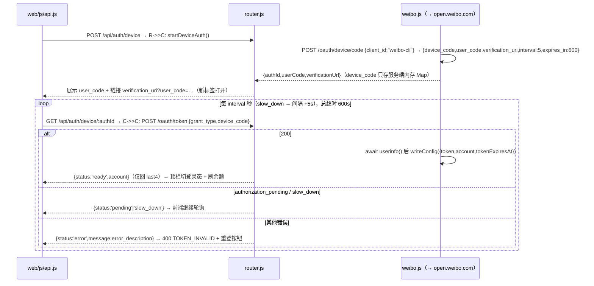
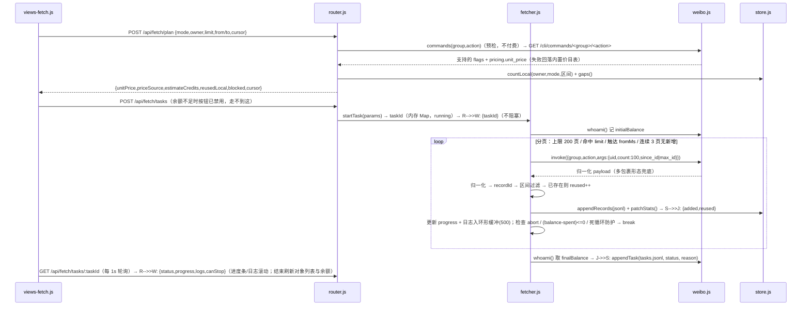
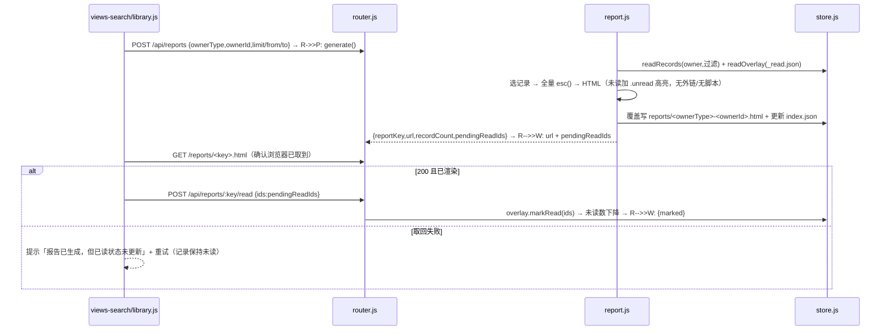
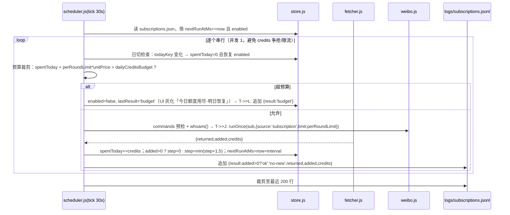
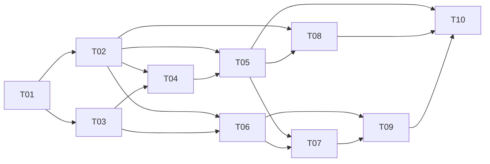

# ARCH — Weibo Reader（Windows Web 版）系统设计 + 任务分解

| 项 | 结论 |
|---|---|
| 语言/栈 | Node.js ≥ 18 内置模块 + 原生 HTML/CSS/ESM，**零第三方依赖、零构建** |
| 模块制式 | **ESM 全项目统一**：`package.json` 写 `"type":"module"`，服务端一律 `import`，**禁止 `require`**；前端一律 `<script type="module">` |
| 监听 | `127.0.0.1:${PORT||7788}`，仅回环 |
| 数据 | `data/` 下 JSON / JSONL / 静态 HTML，无数据库 |
| 事实来源 | 接口一律以 `docs/API-FACTS.md` 为准，不新增字段、不改路径 |

## 1. 方案总览

**进程模型（单进程三合一）**：一个 Node 进程同时承担 ①静态站点托管 ②`/api/*` JSON 接口 ③进程内订阅调度器。启动顺序：加载/初始化 `config.json` → 确保数据目录存在 → 清理过期报告 → `http.createServer` 监听 127.0.0.1 → 启动调度器 `setInterval(30s)`。进程退出即停（订阅与任务均不跨进程存活，符合 PRD Q1 与原应用行为）。

**请求流转**：`server.js` 收流 → `router.js` 按 URL 前缀分流：`/api/*` → 路由表（解析 query/body → 校验 → 调用 store/weibo/fetcher/report/search/scheduler/exchange → 统一包裹返回）；`/reports/*` → 只读托管 `data/reports/`；其余 → `web/` 静态文件，未命中且无扩展名 → 回落 `index.html`（前端用 hash 路由，不用 History API，避免 404）。

**为什么不用框架/数据库**：单用户单机、并发≈1、数据量 1e4~1e5 条——Express 只省几十行路由样板，SQLite 引入二进制依赖反而破坏「双击即跑、无 npm install」。JSONL 追加写天然适合「只增不改的归档」语义，且人类可读可 diff（PRD §6 数据归自己）。取数任务与报告都是长/重操作，用内存作业表 + 轮询而非 SSE/WebSocket：单用户本地无推送必要性，轮询 1s 简单可靠、可断线重连、零额外协议。

**关键取舍**：①记录层 append-only，已读状态用覆盖层文件，**永不改写历史行**；②报告按「每对象一个固定文件名」组织，覆盖写即天然满足 P0-24/P0-32，无需目录清理；③所有付费路径必须经 `weibo.commands()` 预检，缺参即停，绝不盲请求。

## 2. 目录与文件清单（源文件 20 个 = 服务端 12 + 前端 8）

```
weibo-reader-web/
├─ package.json                 ESM 声明、engines>=18、scripts.start（无 dependencies）
├─ start.bat                    双击启动：node server/server.js 后 start 浏览器
├─ docs/{PRD,API-FACTS,ARCH}.md 需求与设计
├─ server/
│   ├─ server.js                启动入口：初始化→建目录→清报告→createServer→启调度器→打印 URL
│   ├─ router.js                /api 路由表 + 静态托管 + body 解析 + 统一响应/错误 + 安全头
│   ├─ config.js                常量：7 模式→group/action 映射、价目表、错误码、上限、路径常量
│   ├─ util.js                  校验（uid/mode/日期/路径）、HTML 转义、时间格式化、拼音排序、日志
│   ├─ store.js                 存储层：路径解析、原子写、JSON/JSONL、recordId、upsert 去重、索引、已读覆盖层、目录切换
│   ├─ weibo.js                 网关客户端：fetch 封装、错误分类、device 三连、whoami、commands 预检、invoke、超时中止
│   ├─ fetcher.js               取数作业引擎：plan 估算、游标推进、去重入库、进度/日志环形缓冲、停止、task 落盘
│   ├─ search.js                本地搜索：条件交集、逐条扫描、分页、耗时统计
│   ├─ report.js                报告生成：选记录、HTML 构建（全转义）、未读高亮、唯一化、待标记 ID 列表
│   ├─ scheduler.js             订阅调度：30s tick、退避阶梯、日预算裁剪、串行执行、日志裁剪 200
│   ├─ demo.js                  演示数据 seed（写入 data/demo/，含用户/博文/记录/订阅/日志）
│   └─ exchange.js              数据包导出（剔 token/订阅/备注/已读）与导入去重合并
├─ web/
│   ├─ index.html               单页壳：顶栏 + 6 项侧边栏 + 视图容器 + 演示横幅
│   ├─ css/app.css              全局样式、骨架屏、进度条、未读高亮、深色适配
│   └─ js/
│       ├─ api.js               fetch 封装、错误码→中文文案、formatTime、DOM 工具、loading 态
│       ├─ app.js               hash 路由 + 视图注册表 + 顶栏状态/余额刷新 + 统一错误条
│       ├─ views-library.js     总览、用户库/详情（分组+时间轴+gap）、博文库/详情
│       ├─ views-fetch.js       取数页：模式表单联动、预估、任务面板轮询、日志滚动、停止
│       ├─ views-search.js      搜索页：关键词+作者+对象+日期、分页、空结果摘要
│       └─ views-config.js      订阅页（CRUD/启停/预算/日志）+ 设置页（账户/目录/导入导出/价目）
└─ data/                        （运行时生成，不入版本控制）
    ├─ config.json               token/账户/余额缓存/设置/价目缓存
    ├─ users.json  posts.json    两个对象索引
    ├─ records/{users|posts}/<id>/   <mode>_<YYYYMM>.jsonl + _read.json
    ├─ subscriptions.json  tasks.jsonl  logs/subscriptions.jsonl
    ├─ reports/index.json  reports/<ownerType>-<ownerId>.html
    ├─ exports/ · demo/          导出包落盘处 / 演示数据独立根（结构同上）
```

## 3. 数据模型

**通用约定**：时间字段一律 `*Ms`（number，epoch 毫秒）；展示串另存 `time`（`YYYY-MM-DD HH:mm:ss`，本地时区）。所有 ID 一律字符串（微博 ID 超 2^53）。字段名 camelCase。

**3.1 `data/config.json`**
| 字段 | 类型 | 必 | 含义 |
|---|---|---|---|
| version | number | 是 | 结构版本，当前 1 |
| token / refreshToken / tokenExpiresAt | string\|null / number\|null | 否 | 令牌与过期 ms（**token 永不回传前端**，仅回 last4） |
| account | `{uid,screenName,avatarUrl,verified}\|null` | 否 | 登录账户快照 |
| balance | `{value,atMs,serviceKind}\|null` | 否 | 余额缓存（接口失败时展示旧值 + 取回时间） |
| pricing / pricingAtMs | `{[mode]:number}` / number\|null | 否 | 单价缓存与取回时间（失败不覆盖） |
| settings | `{dataDir,pageSize,demoMode,reportMaxRecords,logLevel}` | 是 | 用户设置；`pageSize` 默认 20 |

**3.2 `data/users.json`** `{version, users:[…]}`；每项：`uid`(str,必) `screenName`(str,必) `avatarUrl`(str) `remark`(str) `starred`(bool) `addedAtMs`(num) `lastFetchedAtMs`(num|null) `stats:{recordCount:num, unreadCount:num, byMode:{[mode]:num}}`（stats 为写时同步的缓存，可由记录层重建）。
**3.3 `data/posts.json`** `{version, posts:[…]}`；每项：`id`(str,必) `mId`(str|null) `authorUid`(str) `author`(str) `text`(str，≤2000) `textTruncated`(bool) `createdAtMs`(num|null) `sourceUrl`(str) `favorite`(bool) `addedAtMs` `lastFetchedAtMs` `stats`（同上）。

**3.4 记录存档（JSONL，append-only）**
路径规则：`data/records/<ownerType>/<ownerId>/<mode>_<YYYYMM>.jsonl`，`ownerType∈{users,posts}`，`ownerId` 必须 `/^\d{1,20}$/`，`mode∈` 7 枚举，分片键取记录 `ms` 的本地年月。每行一条记录：

| 字段 | 类型 | 必 | 含义 |
|---|---|---|---|
| recordId | string | 是 | **去重键**（规则见下） |
| mode / type / group | string | 是 | 7 模式 key（`sent/received/both/mentions-comments/mentions-posts/post-comments/user-posts`）/ 中文标签（「发出的评论」）/ 方向（与 mode 同枚举值） |
| author / authorUid | string | 是/否 | 作者昵称 / UID |
| time / ms | string / number | 是 | 展示串 / 排序与区间过滤主键 |
| text / textTruncated | string / bool | 是/否 | 纯文本（已去 `回复 @x：` 前缀，≤2000 字符，保留换行）/ 超长截断标记 |
| pictures | `{total:number, items:[{url}]}` | 否 | 配图外链（不下载） |
| postId / postUrl | string | 否 | 原微博 ID / 详情页链接 |
| rootId / replyId / replyAuthor / likes | string / number | 否 | 会话上下文与点赞数 |
| source / fetchedAtMs | `'api'\|'demo'` / number | 是 | 来源与入库时间 |

**已读状态不写在记录行**，而写覆盖层 `data/records/<ownerType>/<ownerId>/_read.json`：`{[recordId]: readAtMs}`。派生：`isUnread = !(recordId in _read)`。好处：入库只 append、标已读只改写小的覆盖文件，零重写历史。

**recordId 生成规则（必须稳定唯一）**：取接口 `idstr`（评论/微博主键）→ 去非数字 → 若为 1~20 位数字串则直接用；若缺失/非法则 `'h:' + sha1( mode + '|' + authorUid + '|' + ms + '|' + text.slice(0,80) ).slice(0,20)`。全库唯一键（导入/去重比较用）= `ownerType + ':' + ownerId + '#' + recordId`。

**3.5 `data/subscriptions.json`** `{version, items:[…]}`；每项：`id`(str,必，`s_<ts>_<rand6>`) `ownerType` `ownerId` `ownerLabel` `mode` `enabled`(bool) `intervalMode`(`auto|fixed`) `fixedMinutes`(num) `perRoundLimit`(num) `dailyCreditsBudget`(num) `spentToday`(num) `todayKey`(`YYYY-MM-DD`) `step`(num，退避下标) `nextRunAtMs` `lastRunAtMs` `lastResult` `createdAtMs`。

**3.6 `data/tasks.jsonl`**（每任务一行，作业结束时追加）：`taskId` `mode` `ownerType` `ownerId` `startedAtMs` `finishedAtMs` `status`(`success|stopped|failed|interrupted`) `returned` `added` `reused` `creditsSpent` `initialBalance` `finalBalance` `reason`。启动时若存在无 `finishedAtMs` 的任务则补一条 `interrupted`（P1-02）。

**3.7 `data/logs/subscriptions.jsonl`**：`{atMs, subId, mode, returned, added, credits, result:'ok|no-new|budget|error', message}`，仅保留最近 200 行（追加后裁剪）。
**3.8 `data/reports/index.json`**：`{version, reports:{ "<ownerType>-<ownerId>": {ownerType,ownerId,title,path,createdAtMs,recordCount,unreadCount} }}`；文件固定名 `reports/<ownerType>-<ownerId>.html`（覆盖写，天然满足 PRD P0-24/P0-32）。

## 4. HTTP API 契约

**统一包裹**：成功 `{"ok":true,"data":…}`；失败 `{"ok":false,"error":{"code":"…","message":"中文人话","details":{}}}`。HTTP 状态语义化：200/400/401/402/404/409/429/500。**错误码枚举**：`BAD_REQUEST` `INVALID_ID` `INVALID_MODE` `INVALID_DATE_RANGE` `NOT_FOUND` `CONFLICT` `UNAUTHORIZED` `TOKEN_INVALID` `INSUFFICIENT_CREDITS` `RATE_LIMITED` `UPSTREAM_ERROR` `UNSUPPORTED_COMMAND` `TASK_NOT_FOUND` `TASK_NOT_RUNNING` `TASK_BUSY` `UNSAFE_PATH` `DEMO_MODE` `IO_ERROR`。

| 方法 路径 | 请求 | 响应 data |
|---|---|---|
| GET `/api/health` · `/api/status` | — | `{ok:true,version,node}` / `{demoMode,loggedIn,account,tokenTail4,balance:{value,atMs,stale},serviceKind,dataDir,counts:{users,posts,unread},todayCredits}` |
| GET `/api/account/balance?refresh=1` | — | `{value,atMs,stale,serviceKind}`（refresh=1 调 whoami，失败 200 返回旧缓存 + `stale:true`） |
| POST `/api/auth/device` | — | `{authId,userCode,verificationUrl,interval,expiresIn}`（device_code 只存服务端内存） |
| GET·DELETE `/api/auth/device/:authId` | — | `{status:'pending'\|'slow_down'\|'ready'\|'expired'\|'error',account?,message?}` / `{cancelled:true}`；ready 时已写 token，响应不含 token |
| POST `/api/auth/token` | `{token}` | 校验 userinfo 成功才落盘：`{account}`；失败 `TOKEN_INVALID` 且**不覆盖旧 token** |
| POST `/api/auth/logout` | — | `{demoMode:true}`（清 token/account，保留数据） |
| GET `/api/users?q=&starred=1` | — | `{items:[{uid,screenName,avatarUrl,starred,stats}],total}` |
| POST `/api/users` | `{input}`（链接/昵称/UID） | `{user,created:bool}`；解析失败 `INVALID_ID`；重复返回已有项 `created:false` |
| GET/PATCH/DELETE `/api/users/:uid` | PATCH `{starred,remark}`；DELETE `?purge=1` | 用户对象 / `{deleted,recordsRemoved}` |
| GET `/api/posts?q=&favorite=1` · POST `/api/posts` | POST `{input}`（详情页链接/微博 ID） | `{items,total}` / `{post,created}`（**不自动取评论**） |
| GET/PATCH/DELETE `/api/posts/:id` | PATCH `{favorite,text?}` | 同用户规则 |
| GET `/api/owners/:type/:id/records` | `?mode=&fromMs=&toMs=&unread=1&page=1&pageSize=20` | `{items:[{recordId,type,group,author,authorUid,time,ms,text,pictures,postUrl,isUnread}],total,page,pageSize,stats,gaps}` |
| POST `/api/owners/:type/:id/read` | `{ids?:string[],mode?:string,all?:bool}` | `{marked,unreadTotal}` |
| POST `/api/fetch/plan` | `{mode,ownerType,ownerId,limit?,fromMs?,toMs?,cursor:'incremental'\|'history'}` | `{unitPrice,priceSource:'api'\|'builtin',estimateCredits,reusedLocal,willFetch,balance,blocked:{code,message}\|null,commands:[{group,action,supported,flags}],cursor:{sinceId?\|maxId?}}` |
| POST `/api/fetch/tasks` | 同 plan | `{taskId}`（立即返回，异步执行；已有运行中任务 → `409 TASK_BUSY`） |
| GET `/api/fetch/tasks/:taskId` | — | `{taskId,status:'running'\|'success'\|'stopped'\|'failed',progress:{page,returned,added,reused,credits,balance},logs:[string],canStop,reason}` |
| GET `/api/fetch/tasks?limit=20` · POST `…/:taskId/stop` | — | `{items:[taskRecord…]}`（读 tasks.jsonl）/ `{stopping:true}`（已落盘数据保留） |
| POST `/api/search` | `{q,author?,ownerType?,ownerId?,fromMs?,toMs?,page=1,pageSize=20}` | `{total,tookMs,page,pageSize,items,conditions}` |
| POST `/api/reports` | `{ownerType,ownerId,limit?,fromMs?,toMs?}` | `{reportKey,url:'/reports/x.html',path,recordCount,unreadCount,pendingReadIds:[…]}` |
| POST `/api/reports/:key/read` | `{ids:[…]}` | `{marked}`（**仅前端确认收到报告后调用**，两段式） |
| GET `/api/reports/:key` · POST `…/open` | — | 报告元信息（无则 `NOT_FOUND`）/ `{opened:true}`（`execFile('cmd',['/c','start','',abs])`，路径须白名单校验） |
| GET `/api/subscriptions` · POST `/api/subscriptions` | POST `{ownerType,ownerId,mode,perRoundLimit,dailyCreditsBudget,intervalMode,fixedMinutes?}` | `{items:[{…,nextRunAtMs,spentToday,status:'active'\|'paused'\|'budget-exhausted'}]}` / `{subscription}` |
| PATCH·DELETE `/api/subscriptions/:id` | PATCH `{enabled?,perRoundLimit?,dailyCreditsBudget?,intervalMode?,fixedMinutes?}` | `{subscription}` / `{deleted:true}` |
| POST `/api/subscriptions/:id/reset-budget` | — | `{subscription}`（spentToday=0、enabled 恢复） |
| GET `/api/subscriptions/:id/logs?limit=200` | — | `{items:[…]}` |
| GET·PATCH `/api/settings` · GET `/api/pricing?refresh=1` | PATCH `{dataDir?,demoMode?,pageSize?,reportMaxRecords?}` | `{settings}`（目录不可写 → `UNSAFE_PATH`/`IO_ERROR` 且不改）/ `{unitPriceByMode,fetchedAtMs,source}` |
| GET `/api/exchange/export` · POST `/api/exchange/import` | POST `{payload}` | JSON 附件 `{schema,exportedAtMs,users,posts,records}`（**无** token/订阅/备注/已读）/ `{added,skipped,usersAdded,postsAdded}` |
| POST `/api/demo/seed` | `{reset?:bool}` | `{seeded:true,counts}`（写 `data/demo/`） |

**静态与分流**：`/api/*` 一律 JSON；`/reports/<file>.html` 从 `data/reports/` 只读托管（白名单 `^[a-z]+-\d+\.html$`）；其余 GET 落 `web/`；`/`、无扩展名路径回落 `index.html`。响应头：`Cache-Control: no-store`（API）、`X-Content-Type-Options: nosniff`、`Referrer-Policy: no-referrer`；不开放 CORS。

## 5. 关键流程时序图

**① 设备码登录**


**② 一次取数任务**


**③ 报告生成与两段式已读**


**④ 订阅巡检一轮**


## 6. 关键算法

**6.1 分页与增量游标**（`fetcher.js`）
- 预检：先 `GET /cli/commands/<group>/<action>`，取 `flags` 与 `pricing.unit_price`；**请求里只放该 action 声明支持的参数**，不支持则降级（如无 `since_id` 就转 `page`），完全无法定位则 `UNSUPPORTED_COMMAND` 停止。
- 增量（`cursor=incremental`，取本地该对象+模式最大数字 `recordId` 作 `since_id`）：`invoke({since_id, count:100})` → 归一化 → 入库（已存在则 `reused++`）→ `nextSince = max(本条返回 id)`。终止：返回 0 条 / `nextSince === since_id` / 触达 `limit` / 最旧记录 `ms < fromMs` / 页数 > 200。
- 历史（`history`，`max_id` 递减）：`max_id = min(返回 id) - 1`（微博 `max_id` 为「≤」语义，必须减 1，否则死循环）。终止：返回 0 条 / 触达 `limit` / `oldestMs < fromMs` / `max_id` 连续两次不变 / **连续 3 页 `added===0`**（防重复计费打转）/ 页数 > 200。
- 任一终止都要写 `reason`；部分成功（中途 5xx，重试一次仍失败）→ `status='failed'` 但已落盘保留，UI 标「区间不完整」，gap 仍显示该区间。

**6.2 gap 待补区间**（`store.gaps(owner,mode,fromMs,toMs)`）记录 `ms` 按本地日分桶得集合 `D`；在 `[fromDay, toDay]`（缺省 `fromDay` = 最早记录日，`toDay` = 今天）内顺序扫描，收集不在 `D` 的连续日段，长度 ≥1 合并为 `{startDay,endDay,days}`，并给出该段建议 `limit`（`days*80` 上限 2000）。复杂度 `O(n log n)`（排序分桶）。点击 gap → `views-fetch.js` 预填 `fromMs/toMs`。

**6.3 credits 估算与本地复用**：`unitPrice` 来自 commands 的 `pricing.unit_price`（仅当 `configured && currency∈{credit,credits}`），失败回落 `config.js` 内置价目表并标 `priceSource:'builtin'`。`willFetch = min(limit ?? 默认500, 预估可拉条数)`，`estimateCredits = ceil(willFetch * unitPrice)`。**复用判定**：同一 `(owner,mode,区间)` 二次执行时，返回记录若 `recordId` 已在本地 → 计入 `reused` 不计入 `added`，界面显示「复用本地 X 条 / 新增 Y 条」；估算按 returned 上限保守给出，实际花费以服务端扣费为准。**保护**：`estimateCredits > balance` → `INSUFFICIENT_CREDITS` 且前端禁用「开始」并显示差额；运行中 `balance - spent <= 0` → 立即 abort，`reason='余额跌破预估'`。

**6.4 订阅退避与预算**（`scheduler.js`）：`auto`：阶梯 `[1,3,5,10,15,30]` 分钟；本轮 `added>0` → `step=0`；`added===0` → `step=min(step+1,5)`。`fixed` 直接用 `fixedMinutes`。每轮预估 `perRoundLimit * unitPrice`；`spentToday + 预估 > dailyCreditsBudget` → 本轮跳过、`enabled=false`、`lastResult='budget'`、写日志（UI 显示「今日额度用尽·明日自动恢复」+「重置额度」）。`todayKey` 改变即归零 `spentToday` 并恢复 `enabled`。全局并发 1，串行执行。

**6.5 本地搜索**（`search.js`）：**选择逐条扫描而非倒排**——单用户本地典型 1e4~1e5 条、单条 ≤2000 字符，全量 `toLowerCase().includes()` 扫描约 50~200ms，完全满足「0 credits 即时搜索」；倒排需中文分词（无第三方依赖只能 bigram），索引体积膨胀 2~3 倍且需增量维护一致性与失效逻辑，复杂度与故障面均大于收益。实现：按对象目录懒加载记录到内存（LRU 上限 8 个 owner，失效条件 = 目录内文件 `mtime` 变化），条件取交集（`q` 空格分词全命中、`author` 匹配昵称或 UID、`owner` 精确、`fromMs/toMs` 区间），先算 `total` 再 `slice((page-1)*20, page*20)`，返回 `tookMs`。复杂度 `O(N*L)`，N=库内记录数，L=关键词数。

## 7. 共享约定（跨文件必须一致）

1. **模块制式**：`package.json` `{"type":"module"}`；服务端所有文件 ESM（`import fs from 'node:fs'`），**不出现 `require`/`module.exports`**；前端 `type="module"`，跨文件只用具名 export。
2. **响应形状**：`{ok,data}` / `{ok:false,error:{code,message,details}}`；`router.js` 提供 `ok(res,data)` 与 `fail(res,status,code,message,details)`，业务函数只 `throw new AppError(code,message,status)`。
3. **时间**：存储与比较一律 `*Ms`（毫秒）；展示串 `YYYY-MM-DD HH:mm`；日期输入 `YYYY-MM-DD` 解析为本地 `00:00:00`，结束日按 `23:59:59.999`（「包含所选当天」）；时间戳解析失败 → `INVALID_DATE_RANGE`。
4. **ID 与模式校验**：`uid/postId` 必须 `/^\d{1,20}$/`；`mode` 必须命中 `config.js` 枚举；任何拼进路径的片段先过校验，`path.resolve(...)` 结果必须 `startsWith(root)`，否则 `UNSAFE_PATH`。
5. **HTML 安全**：所有进 HTML 的文本必过 `esc()`（`& < > " '` → 实体），换行渲染为 `<br>`（保留纯文本语义）；报告与前端均不使用 `innerHTML` 拼接未转义内容。
6. **日志行格式**：`[YYYY-MM-DD HH:mm:ss] LEVEL module event key=value …`；任务日志另存内存环形缓冲（最近 500 行）。
7. **演示数据隔离**：`demoMode` 时 `store` 的 root 指向 `data/demo`（结构与真实根完全一致），所有读写天然隔离；`demoMode` 下 `weibo.*` 一律抛 `DEMO_MODE`，保证零付费请求。
8. **并发与目录**：全局同一时刻只允许 1 个取数任务（含订阅），由 `fetcher.running` 标志互斥；切换数据目录前须无运行中任务。

## 8. 任务列表（按实现顺序）

| ID | 任务 | 文件 | 完成判据 |
|---|---|---|---|
| T01 | 项目骨架 + HTTP 基座 | `package.json` `start.bat` `server/config.js` `server/util.js` `server/router.js` `server/server.js` `web/index.html` | `node server/server.js` 打印 `http://127.0.0.1:7788`；`/api/health` 返回 `{ok:true}`；`GET /` 出首屏；未知 `/api/x` 返回 404 JSON；无 `require` |
| T02 | 存储层 + 记录/索引/已读覆盖层 | `server/store.js`（+ `node:test` 单测） | 单测覆盖：recordId 稳定且幂等、`../` 穿越被拒、同批重复入库 `added=0`、`_read.json` 覆盖后 `isUnread=false`、原子写断电不留半文件 |
| T03 | 微博网关客户端 | `server/weibo.js`（+ 注入 fetch stub 的单测） | 覆盖 401→`TOKEN_INVALID`、402/quota→`INSUFFICIENT_CREDITS`、`slow_down` 间隔 +5s、8s 超时 abort、data/首个数组字段双形态解析 |
| T04 | 账户/设置/价目 API + 前端外壳 | `router.js`(auth,status,settings,pricing) `web/css/app.css` `web/js/api.js` `web/js/app.js` | 登录弹窗展示 user_code 与链接并轮询成功写 token；顶栏显示余额（失败显示缓存+时间）；6 个 hash 视图切换无 404；手动 token 校验失败不覆盖旧值 |
| T05 | 用户库 / 博文库（存储 + API + UI） | `store.js`(索引 CRUD) `router.js`(users,posts) `web/js/views-library.js` | 3 种链接格式与纯 UID 均可添加；重复添加 `created:false` 且不产生重复；星标置顶、昵称/UID 即时过滤；博文详情显「尚未获取评论」 |
| T06 | 取数作业引擎 | `server/fetcher.js` | stub 网关下「历史分页」与「增量」两用例游标推进正确；`limit`/`fromMs`/无新增 3 页三种终止均生效；`stop()` 后已入库条数不变；结束时写 `tasks.jsonl` |
| T07 | 取数 API + 取数页 | `router.js`(fetch,records,read) `web/js/views-fetch.js` | 7 模式表单字段随模式变化；预估 > 余额时禁用开始并显示差额；进度条+日志 1s 轮询刷新；点击 gap 预填表单；停止后状态 `stopped` |
| T08 | 本地搜索 + 报告 | `server/search.js` `server/report.js` `router.js`(search,reports) `web/js/views-search.js` | 四条件交集 + 每页 20 + `total/tookMs` 正确；正文含 `<script>alert(1)</script>` 的报告不执行脚本且保留换行；两段式已读生效、失败保持未读；重复生成仅 1 个文件 |
| T09 | 订阅调度 | `server/scheduler.js` `router.js`(subscriptions) `web/js/views-config.js` | 退避按 1→3→5→10→15→30 推进、有新增即回到 1；预算耗尽自动暂停并写日志；日志只留 200 条；暂停/恢复/重置额度生效 |
| T10 | 演示数据 + 导入导出 + 联调收尾 | `server/demo.js` `server/exchange.js` `router.js`(demo,exchange) `start.bat` | `DEMO_MODE=1` 无 token 时全流程（浏览/搜索/报告/订阅）可走通且零付费请求调用；导出包不含 token/订阅/备注/已读；导入返回 `added/skipped` 正确；`.bat` 双击可用 |

依赖：T02→T01；T03→T01；T04→T02,T03；T05→T02,T04；T06→T02,T03；T07→T05,T06；T08→T02,T05；T09→T06,T07；T10→T05,T08,T09。



## 9. 待明确事项（含默认假设）

| # | 问题 | 默认假设（按此实现） |
|---|---|---|
| A1 | `/cli/invoke` 返回的真实包裹字段（`data` / `statuses` / `comments`）在 7 个 action 下是否一致？ | 实现「多形态归一化」：`payload.data` → `payload.statuses` → `payload.comments` → 首个数组字段；归一化失败记 `UPSTREAM_ERROR` 并停止该页，不猜测结构 |
| A2 | `user_timeline/biz` 是否 404？回退后参数是否仍需 `uid`？ | 预检时先试 `biz`，404 则回退 `statuses/user_timeline/other` 并在任务日志与 UI 提示「已回退到 other 接口」；回退后仍用 `uid` |
| A3 | 单价 `pricing.unit_price` 缺失时的内置价目表数值？ | `config.js` 内置保守值（评论类 0.02、微博类 0.05 credits/条，`priceSource:'builtin'` 明示为估算）；「查询最新单价」成功即覆盖，失败不清空已有缓存 |
| A4 | 单对象记录量极大（>10 万条）时启动/搜索是否可接受？ | 接受：记录按「对象+模式+年月」分片，列表与搜索按对象目录懒加载 + LRU(8)；若实测单对象 >20 万条导致首屏 >1s，再对 `stats` 做 `data/index/*.json` 预聚合（不改对外契约） |
